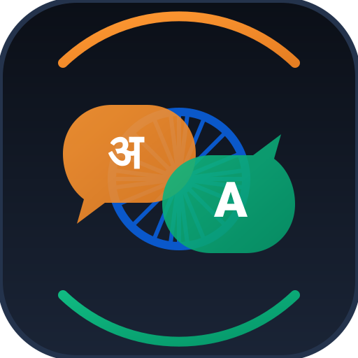

# Bharat Translator (भारत अनुवादक) 🇮🇳

> **A real-time, responsive, two-way speech and text translator for all languages spoken in India.**  
> Built for travelers, tourists, and business professionals communicating face-to-face across different states and languages in India.



---

## 🌟 Key Features

### 1. Complete Indian Language Support (A to Z)
Includes all **22 Scheduled Languages of the Indian Constitution + English** (23 languages total), strictly ordered **alphabetically from A to Z** in every selector, displaying both English and native script names:
1. **Assamese** - অসমীয়া
2. **Bengali** - বাংলা
3. **Bodo** - बड़ो
4. **Dogri** - डोगरी
5. **English** - English
6. **Gujarati** - ગુજરાતી
7. **Hindi** - हिन्दी
8. **Kannada** - ಕನ್ನಡ
9. **Kashmiri** - कॉशुर / کٲشُر
10. **Konkani** - कोंकणी
11. **Maithili** - मैथिली
12. **Malayalam** - മലയാളം
13. **Manipuri (Meitei)** - মৈতৈলোন্
14. **Marathi** - मराठी
15. **Nepali** - नेपाली
16. **Odia** - ଓଡ଼ିଆ
17. **Punjabi** - ਪੰਜਾਬੀ
18. **Sanskrit** - संस्कृतम्
19. **Santali** - ᱥᱟᱱᱛᱟᱲᱤ
20. **Sindhi** - سنڌي / सिंधी
21. **Tamil** - தமிழ்
22. **Telugu** - తెలుగు
23. **Urdu** - اردو

### 2. Dual Panel Side-by-Side Layout
- **Left Panel ("Speaking Language")**: Mother tongue input area with live typing and voice transcription.
- **Phonetic Slang Typing (English to Pure Native Script)**: Users don't need a regional keyboard! You can type slang words using English/Roman letters (e.g., Telugu: `nuvvu`, `nenu`, `ela unnavu`; Hindi: `aap kaise ho`, `kya haal hai`; Tamil: `epdi irukinga`, `vanakkam`). The app automatically converts your slang into pure native script spellings (`నువ్వు`, `నేను`, `आप कैसे हो`, `வணக்கம்`).
- **Pure Native Script Guarantee**: Translations into Indian languages are strictly rendered in their authentic native scripts (Devanagari, Telugu, Tamil, Bengali, Gurmukhi, etc.) — never in Romanized English letters! Only when English is the target language does it display in English.
- **Center Swap Button (⇄)**: Inverts languages and swaps text boxes with 180° rotation animation.
- **Right Panel ("Translated Language")**: Displays translated output in native scripts simultaneously.
- **Responsive Design**: Side-by-side on desktop/tablet, gracefully stacked on mobile phones with touch targets $\ge 48\text{px}$.

### 3. Voice & Speech Options (Web Speech API)
- **Speech-to-Text (STT)**: Large microphone button with animated recording ring and live interim transcription badge.
- **Text-to-Speech (TTS)**: High-quality audio read-aloud buttons on both panels with auto accent matching (`hi-IN`, `ta-IN`, `pa-IN`, `en-IN`, etc.).
- **Voice Diagnostic & Fallback**: Automatically checks device-installed voices and displays graceful notifications when native regional voice packages are absent on the client machine, without interrupting text translation.

### 4. Conversation Mode (Live Two-Way Talking)
- Dedicated face-to-face conversation interface with large turn-taking mic buttons:
  - **Button 1: "YOU" (Speaking Language)**: You speak $\to$ live transcription $\to$ translates $\to$ speaks aloud in partner's language.
  - **Button 2: "PARTNER" (Partner Language)**: Partner speaks $\to$ translates $\to$ speaks aloud in your language.
- **Chat Dialogue History**: Timestamped conversation bubbles with original text, translated text, one-click audio playback, and copy buttons.
- Real-time status indicators: `"Listening..."`, `"Translating..."`, `"Speaking..."`, `"Ready"`.

### 5. Extra Travel Utilities
- **One-click Copy**: Instant clipboard copy with feedback toast.
- **Save Favorite Phrases (★)**: Star translations to store in local memory.
- **Preloaded Essential Phrasebook**: Curated categories (Essentials, Travel & Directions, Food & Dining, Shopping & Bargaining, Emergency & Health, Business & Meetings).
- **Offline-Friendly PWA**: Installable on Android, iOS, Windows, and macOS via `manifest.json` and `sw.js`.
- **Dark & Light Mode**: Vibrant theme engine with deep indigo/slate dark mode and warm Indian saffron (`#FF9933`) and emerald (`#10B981`) accents.

---

## 🏗️ Architecture & Project Structure

```
bharat-translator/
├── index.html              # Responsive single-page application UI
├── manifest.json           # Progressive Web App (PWA) manifest
├── sw.js                   # Service Worker for offline PWA caching
├── package.json            # Node.js project configuration
├── server.js               # Node.js backend proxy server (zero external npm dependencies)
├── server.ps1              # Native Windows PowerShell backend proxy server
├── .env.example            # Environment variables template
├── .env                    # Local environment variables (keeps API keys private)
├── css/
│   └── styles.css          # Mobile-first CSS, dark/light themes, animations
├── js/
│   ├── config.js           # 23 languages sorted A-Z with BCP-47 speech codes
│   ├── phrases.js          # Categorized essential travel phrases & offline dictionary
│   ├── speech.js           # Web Speech API engine (STT, TTS, voice fallbacks)
│   ├── translator.js       # Multi-tier translation client (Proxy -> Cloud -> Offline)
│   ├── storage.js          # LocalStorage favorites, chat history, and settings
│   └── app.js              # Application controller & conversation mode coordinator
└── icons/
    └── icon.svg            # Ashoka Chakra & multilingual speech bubbles icon
```

---

## 🚀 How to Run the App

You can run Bharat Translator using **either PowerShell (no install required on Windows)** or **Node.js**:

### Option 1: Native Windows PowerShell (Zero Installation)
No Node.js or npm needed! Simply open PowerShell in the project directory:
```powershell
powershell -ExecutionPolicy Bypass -File .\server.ps1
```
Open your browser at:  
👉 **`http://localhost:3000`**

### Option 2: Node.js (All Platforms)
If you have Node.js installed:
```bash
node server.js
```
Open your browser at:  
👉 **`http://localhost:3000`**

### Option 3: Direct Browser Launch
You can also double-click `index.html` to open it in Chrome, Edge, or Brave. In direct browser mode, client-side translation and offline travel phrases work automatically!

---

## 🔑 Translation APIs & Environment Variables

Bharat Translator keeps all API keys strictly on the server backend inside `.env` so they are **never exposed to client browsers**.

The app uses a 3-tier cascade:
1. **Tier 1 (Configured API)**: If an API key is set in `.env`, the backend uses that service.
2. **Tier 2 (Free Cloud Fallback)**: If no keys are provided, the backend falls back to free translation endpoints.
3. **Tier 3 (Offline Travel Dictionary)**: If offline or disconnected, the built-in dictionary handles essential travel expressions.

### How to configure keys in `.env`:

```ini
PORT=3000

# 1. Govt. of India Bhashini ULCA API (Specialized for Indian Languages)
BHASHINI_API_KEY=your_bhashini_api_key_here
BHASHINI_USER_ID=your_bhashini_user_id_here
BHASHINI_PIPELINE_ID=your_pipeline_id_here

# 2. Google Cloud Translation API
GOOGLE_TRANSLATE_API_KEY=your_google_cloud_api_key_here

# 3. Azure Cognitive Services Translator
AZURE_TRANSLATOR_KEY=your_azure_translator_key_here
AZURE_TRANSLATOR_REGION=centralindia

# 4. Google Gemini API (High contextual fluency)
GEMINI_API_KEY=your_gemini_api_key_here
```

### How to obtain API keys:
- **Govt. of India Bhashini**: Register at [Bhashini ULCA Portal](https://bhashini.gov.in/en/).
- **Google Cloud Translation**: Go to [Google Cloud Console](https://console.cloud.google.com/) $\to$ Enable Cloud Translation API $\to$ Credentials $\to$ Create API Key.
- **Azure Translator**: Go to [Azure Portal](https://portal.azure.com/) $\to$ Create "Translator" cognitive service $\to$ Keys and Endpoint.
- **Google Gemini API**: Generate a free Gemini key at [Google AI Studio](https://aistudio.google.com/).

---

## 🎙️ Speech Compatibility Guide

| Language | Recognition (STT) | Synthesis (TTS) | Accent Code |
| :--- | :---: | :---: | :---: |
| **English** | ✅ Supported | ✅ Supported | `en-IN` / `en-US` |
| **Hindi (हिन्दी)** | ✅ Supported | ✅ Supported | `hi-IN` |
| **Punjabi (ਪੰਜਾਬੀ)** | ✅ Supported | ✅ Supported / Fallback | `pa-IN` |
| **Tamil (தமிழ்)** | ✅ Supported | ✅ Supported | `ta-IN` |
| **Bengali (বাংলা)** | ✅ Supported | ✅ Supported | `bn-IN` |
| **Telugu (తెలుగు)** | ✅ Supported | ✅ Supported | `te-IN` |
| **Marathi (मराठी)** | ✅ Supported | ✅ Supported | `mr-IN` |
| **Gujarati (ગુજરાતી)** | ✅ Supported | ✅ Supported | `gu-IN` |
| **Urdu (اردو)** | ✅ Supported | ✅ Supported | `ur-IN` |

*Note: On browsers where an operating system voice package is missing for a specific regional dialect, Bharat Translator shows a clear notification and continues with accurate text translation.*

---

## 📱 Installing as a PWA on Mobile
1. Open `http://localhost:3000` (or your deployed URL) on Chrome (Android) or Safari (iOS).
2. Tap the browser menu ($\vdots$ or Share).
3. Select **"Add to Home Screen"** or **"Install Bharat Translator"**.
4. The app will launch fullscreen with offline access to travel phrases!

---

## 📄 License
MIT License. Built for seamless communication across India.
